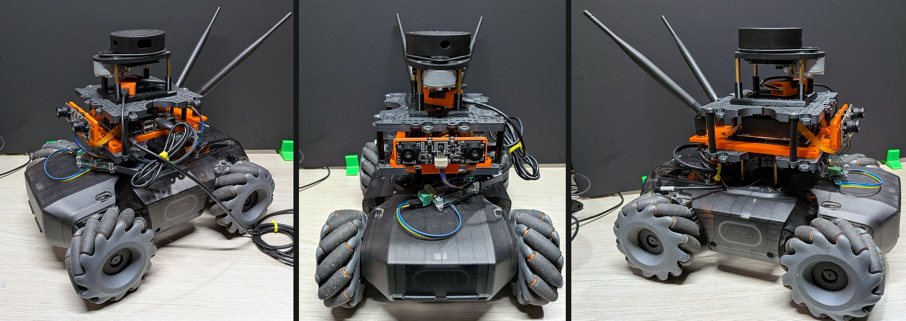
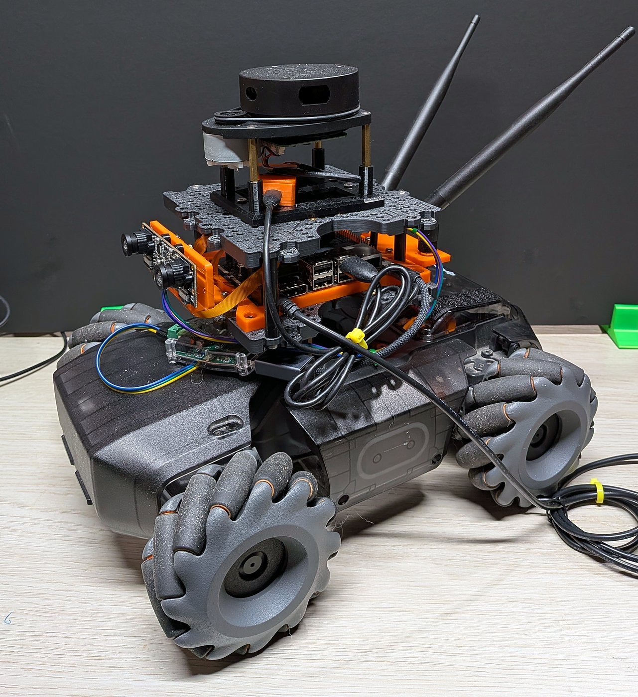
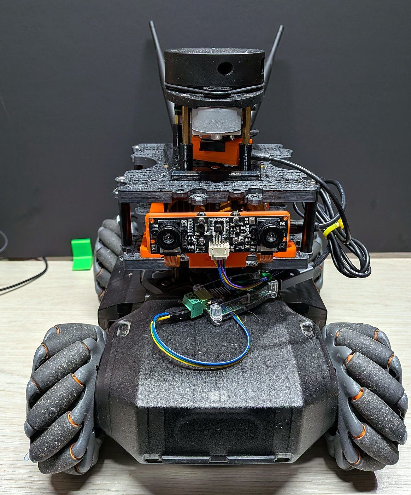
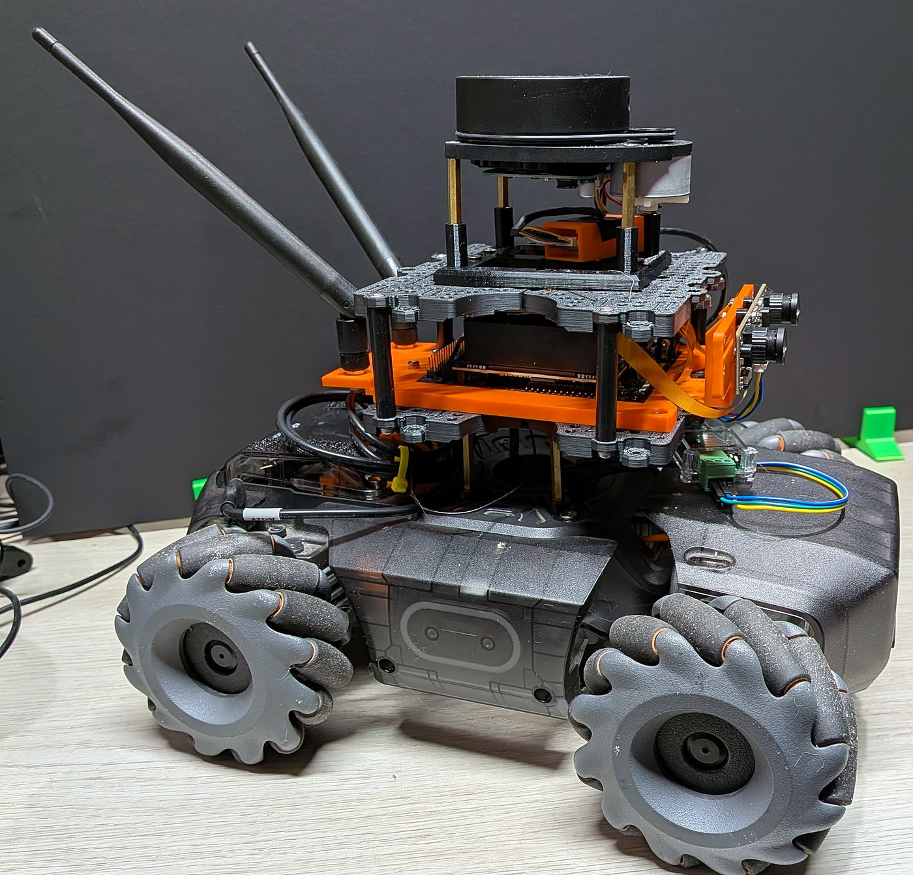

# RoboMaster S1 Jetson



This project turns a DJI RoboMaster S1 into a ROS 2 mobile robot controlled by a
Jetson Orin Nano over direct CAN. It includes gamepad driving, LiDAR obstacle
avoidance, calibrated stereo camera streaming, RTAB-Map mapping experiments,
and an Isaac Sim environment for testing navigation and patrol.

The Python driver and Jetson deployment are the main hardware workflow. The
original C++ library remains the protocol reference and provides diagnostic tools.
This fork builds on [proroklab/robomaster_sdk_can](https://github.com/proroklab/robomaster_sdk_can)
and the reverse-engineered S1 protocol, with reference to the
[DJI RoboMaster SDK](https://github.com/dji-sdk/RoboMaster-SDK). It retains the
[MIT license](LICENSE). This is an unofficial project, not supported by DJI.

## First installation

Start with [public deployment setup](docs/public-setup.md) before running any
hardware commands below. All `192.0.2.*` addresses in this repository are
non-routable documentation examples. Local network settings and calibration
must be supplied for your robot. The service templates use the example account
`ubuntu` and checkout `/home/ubuntu/robomaster-s1-jetson`.

## What works today

This source snapshot includes hardware work through October 12, 2026 and
simulation work through October 31, 2026. Features remain experimental; dates
refer to recorded development trials, not validation on a new installation.

| Capability | Current state |
|---|---|
| Direct CAN chassis control | Python driver tested on the real S1; command watchdog and USB reconnect recovery validated |
| Gamepad driving | L1-gated control, with Jetson boot services for CAN, chassis and teleoperation |
| LiDAR and stereo cameras | RPLIDAR A1 scans and calibrated IMX219 stereo streams available through ROS 2; sensor services installed |
| Map-free patrol | Supervised hardware trials avoided a box and a wall; simulation patrol runs continuously |
| Stereo mapping | RTAB-Map databases, point clouds and occupancy-grid images saved; room coverage and map accuracy remain experimental |
| Mapping patrol stop guard | Waits for healthy stereo tracking and latches a stop on reported tracking loss or stale updates |
| Gyroscope feedback | CAN-derived yaw rate published at approximately 10 Hz; sign checked against a physical left turn |
| Sensor fusion | LiDAR/stereo/gyro estimator is work in progress, not validated for driving or connected to mapping patrol |
| Hardware navigation to map goals | Guarded short forward trials only; general navigation and return remain unvalidated |

Patrol is reactive obstacle avoidance, not room-coverage planning. Stereo tracking
can still fail near low-texture surfaces. Accelerometer translation, full IMU
orientation, wheel odometry and battery feedback are not validated ROS inputs.

## Our setup

| Component | Role |
|---|---|
| [DJI RoboMaster S1](https://www.dji.com/robomaster-s1) | Original Motion Controller and four M-BUS motors |
| [NVIDIA Jetson Orin Nano](https://developer.nvidia.com/embedded/learn/get-started-jetson-orin-nano-devkit), Ubuntu 22.04 / ROS 2 Humble | CAN driver, gamepad, LiDAR, stereo camera capture and hardware patrol |
| [DSD TECH SH-C31A USB-CAN adapter](https://www.deshide.com/product-details_SH-C31A.html) | SocketCAN `can1`, 1 Mbps on our Jetson |
| [SLAMTEC RPLIDAR A1](https://www.slamtec.com/en/lidar/a1) | `/scan` for obstacle checks |
| [IMX219-83 stereo camera](https://www.waveshare.com/IMX219-83-Stereo-Camera.htm), 60 mm measured baseline | Dual IMX219 images for visual odometry and mapping; see board-identification note below |
| Dell laptop, ROS 2 Jazzy | Stereo rectification, RTAB-Map and map inspection |
| Separate Isaac Sim host, ROS 2 Jazzy | Simulated robot, patrol and Nav2 experiments |

| Front-left | Front | Right side |
|---|---|---|
| [](docs/images/robot-front-left.jpg) | [](docs/images/robot-front.jpg) | [](docs/images/robot-side-right.jpg) |

From top to bottom: the RPLIDAR A1 on standoffs, the Jetson Orin Nano with two
Wi-Fi antennas on 3D-printed plates, the IMX219-83 stereo camera facing forward,
and the SH-C31A USB-CAN adapter wired to the S1 chassis CAN bus. The original
gimbal and blaster are removed.

Links point to manufacturer product or support pages. Our camera records identify
an IMX219-83 / Waveshare-style stereo board, but still mark the exact board label
as unconfirmed; the camera link is that recorded model's reference. Exact Dell
laptop and simulation-host hardware models are not recorded here.

Hardware uses **ROS domain 42**; simulation uses **domain 43**. The public
templates use example paths and addresses: Jetson
`ubuntu@192.0.2.10`, Isaac host `ubuntu@192.0.2.33`, and Jetson checkout
`/home/ubuntu/robomaster-s1-jetson`. Review these before using another setup.
Cross-distribution communication has been tested for our streams; it is not a
promise that arbitrary Humble and Jazzy message packages interoperate.

## Start here

For a fresh robot, follow these guides in order:

1. [Hardware, wiring and initial motion checks](docs/hardware-and-safety.md).
2. [Chassis calibration](docs/chassis-calibration.md). Calibration resolved the
   observed stationary rollover/Stop Mode problem on our robot.
3. [Jetson installation and CAN/ROS services](docs/jetson-orin-nano.md).
4. [Gamepad setup and automatic startup](docs/gamepad.md).
5. [LiDAR setup](docs/rplidar-a1-ros2.md) and
   [stereo calibration and rectification](docs/stereo-calibration.md).

The commands below are for the **already configured deployment**, not a complete
installation procedure. Keep L1 released when changing control modes, supervise
hardware patrol, and keep a physical power cutoff accessible. Only one motion
controller should own `/cmd_vel` at a time.

### Check the Jetson after boot

Run in the Jetson checkout:

```bash
cd /home/ubuntu/robomaster-s1-jetson
source /opt/ros/humble/setup.bash
source ros2_install/setup.bash
export ROS_DOMAIN_ID=42
export RMW_IMPLEMENTATION=rmw_fastrtps_cpp
export ROS_LOCALHOST_ONLY=0
source scripts/deployment_env.sh
export FASTRTPS_DEFAULT_PROFILES_FILE="$ROBOMASTER_DDS_PROFILE"
unset FASTDDS_DEFAULT_PROFILES_FILE

systemctl is-active robomaster-can robomaster-chassis \
    robomaster-joy robomaster-teleop robomaster-lidar robomaster-cameras
ros2 topic list
```

To inspect commands in that terminal:

```bash
ros2 topic echo /cmd_vel geometry_msgs/msg/Twist
```

A listed topic or active service does not prove data delivery or wheel movement.
See [troubleshooting](docs/validation-and-troubleshooting.md) and inspect recent
logs with `journalctl -b -u robomaster-chassis --no-pager`.

**Hardware command values are not calibrated metres per second or radians per
second.** The chassis configuration scales them into raw wheel commands. Positive
`linear.x` is forward and positive `angular.z` turns left. The chassis timeout is
0.35 seconds after commands stop.

### Run hardware patrol

First run the non-driving scan check on the Jetson:

```bash
bash scripts/run_patrol_robot.sh --check
```

This runs for 15 seconds and publishes to `/patrol/check_cmd_vel`. For a supervised
120-second obstacle-avoidance trial:

```bash
bash scripts/run_patrol_robot.sh --drive
```

The driving launcher pauses gamepad teleoperation and restores it on exit if it
was previously active. Ctrl-C ends the trial. Missing, stale or insufficient scan
coverage stops motion; `duration complete` is the normal end of the timed run.
Hardware patrol does not start automatically at boot.
See [patrol modes, clearances and limitations](docs/patrol.md).

### Create a stereo map

On the configured **Dell laptop**, close other stereo previews, leave any Conda
environment, and run from this checkout:

```bash
bash scripts/run_hardware_stereo_mapping.sh
```

To draw walls and free space from the RPLIDAR while retaining stereo odometry
and visual loop recognition, use `bash scripts/run_hardware_stereo_mapping.sh --lidar`.
This creates a separate `lidar-stereo-*.db`. It uses the recorded relative
camera/laser mount and a 5 cm occupancy grid. Scan handedness and map accuracy
still need physical validation; it does not enable the experimental fused estimator.

The launcher opens RTAB-Map and prints the new database path under
`maps/hardware/`. It does not publish motor commands. It requires the laptop's
configured Python environment, ROS 2 Jazzy/RTAB-Map and the saved camera calibration.

Use the gamepad to map manually, or, once tracking is healthy, run this on the
**Jetson** for a supervised mapping patrol:

```bash
bash scripts/run_patrol_robot.sh --mapping
```

This mode requires fresh stereo tracking. Tracking loss latches a stop even if the
UI later returns to green; end the patrol and restart it after tracking recovers.
The guard detects reported loss, not every inaccurate pose. The current hardware
mapping pipeline uses **stereo odometry**, not the unfinished fused estimator.
See [stereo mapping details](docs/stereo-calibration.md) and
[the mapping patrol guard](docs/patrol.md#patrol-during-stereo-mapping).

### Localize on the saved hardware map

On the Dell laptop, stop mapping and run:

```bash
bash scripts/run_hardware_localization.sh
```

This loads the measured `refined-area-20261010/refined-area.yaml` map, checks
for fresh LiDAR scans, and starts LiDAR odometry, AMCL and RViz. An optional
`map.yaml` argument selects another occupancy map; `--headless` skips RViz.
Generated map files must already exist in this checkout.

Keep the robot stationary initially. Select **2D Pose Estimate**, click its
approximate position on the map and drag in its forward direction. Cyan laser
points should align with the mapped walls. The estimate refers to the laser
centre, using `localization_map -> localization_odom -> laser`; the chassis
reference and motion accuracy still need validation before adding Nav2 control.
This launcher publishes no motor commands. Ctrl-C stops the session.
It wakes LiDAR through the Jetson sensor manager, leaving cameras off.
The cleaned floorplan PNG is a visual approximation; use the measured occupancy
map for this check.

For a repeatable start, place the robot on its marked home rectangle and facing
arrow, align with **2D Pose Estimate**, and keep it stationary. Save that alignment
on the Dell with `bash scripts/save_hardware_home.sh`. The helper requires fresh
scans, a current map-to-laser transform and stationary odometry. It records
`maps/hardware/home-pose.yaml`, preserving a backup of any previous home pose.
Subsequent localization starts load this home estimate automatically. Place the
robot on the same mark and heading each time. If it starts elsewhere, use
`bash scripts/run_hardware_localization.sh --manual` and set its pose in RViz.
The saved home is tied to the map contents; changing the map requires a new
alignment. Restoring home does not enable motor control or guarantee localization.

Hardware Nav2 preparation is in `config/hardware_nav2_preview.launch.py` and
`config/hardware_nav2_preview.yaml`. The launch requires measured `length`,
`width` and `laser_to_front` arguments in metres. Start it from a terminal with
the same domain-42 DDS environment as localization. Its controller and behavior
output goes to `/hardware_navigation/cmd_vel_nav`; the smoother publishes only
`/hardware_navigation/cmd_vel_preview`. It does not drive the chassis. The laser
reference is provisional for motion control, and no calibrated velocity bridge
is enabled. The simulation launcher remains separate.

To record a supervised manual calibration trial on the Dell while localization
is running:

```bash
bash scripts/record_hardware_motion.sh --seconds 60 \
  --output maps/hardware/motion-forward-trial.json
```

Record one straight gamepad movement, release L1 to stop, and measure the actual
distance with a tape. The recorder saves existing `/cmd_vel` commands and valid
`/localization/odom` poses; it never publishes commands and does not automatically
apply gains. A filename cannot be reused. Forward, turning and lateral commands
require separate validation; turning also moves the laser relative to the chassis
centre. Missing samples invalidate a trial.

### First supervised hardware navigation trial

With localization running and aligned, launch the Nav2 preview in the same ROS
domain and DDS environment:

```bash
ros2 launch config/hardware_nav2_preview.launch.py \
  length:=0.32 width:=0.24 laser_to_front:=0.155
```

The dimensions are the recorded 24 cm outer wheel width and accepted stock
32 cm length. For the first forward-only goal, with clear space ahead and the
operator beside the robot, run on the Dell:

```bash
bash scripts/run_hardware_navigation_trial.sh --dry-run
bash scripts/run_hardware_navigation_trial.sh
```

For arrival at the point without requiring the final heading, add
`--position-only`. Both modes retain the 5 cm position tolerance and the 15-degree
trial heading-change guard. The default mode still requires the requested final
heading; its small turning commands have not reliably completed that correction.
Position-only mode uses a minimum abstract forward command of 0.45 for positive
requests above 0.001 m/s, retaining the maximum nominal 0.08 m/s command bound.
Zero requests stop immediately. This floor is a candidate from the forward
recording, where commands in the 0.4–0.5 range produced movement; it still needs
supervised arrival verification. Turning retains its existing limit.

Dry-run checks sensors and plans a path without commanding movement. The actual
trial uses the saved forward/turning conversion candidates to follow one path to
a point 30 cm ahead. It limits forward command speed to 0.08 m/s, duration to
20 seconds, travel to 45 cm and heading change to 15 degrees. Turning retains the
original continuous command limit of 0.15 rad/s. Experimental command pulses
were reverted after a supervised trial reached the heading-change stop.
Arrival and return remain unvalidated. The helper saves
requested velocities, emitted commands, localized poses and stop reasons under
`maps/hardware/trial-traces/` after each actual trial. It rejects
reverse/lateral commands, stale scans/odometry/localization
and inadequate obstacle clearance. Faults latch a stop; five seconds without
localized position or heading progress also stops the forward trial.

The goal checker and DWB approach tolerance must both be 5 cm. Restart the
Nav2 preview after editing these tolerances: RotateToGoal caches its value when
initialized. A live update left its original 12 cm window active while the goal
checker required 5 cm, causing a stall about 10 cm short. With motor output
disconnected, the 10 cm preview goal requested zero forward velocity before
restart and a median 0.0545 m/s afterward. See the
[Nav2 implementation](https://github.com/ros-navigation/navigation2/blob/jazzy/nav2_dwb_controller/dwb_critics/src/rotate_to_goal.cpp).

Keep the gamepad sticks centred and L1 released. Press L1 to stop this automatic
trial. The ubuntu-owned teleop processes are temporarily paused through a remote
heartbeat lease; on exit they are shut down and systemd starts fresh teleop so
queued drive input is discarded. The joystick reader stays running for the stop
control. The helper `scripts/pause_teleop_for_trial.sh` must exist on the Jetson.

On October 12 the first trial reached its Nav2 goal, recorded approximately 20 cm
of localized travel, and the user confirmed physical movement. The current 12 cm
goal tolerance accepted the 30 cm target early. This result does not validate
arbitrary goals, reverse/lateral motion, or both turning directions. The normal
preview remains disconnected from motors when the trial helper is not running.
Automatic sensor sleep and the associated pose recovery are disabled for hardware
testing. On the Jetson, with the robot parked and L1 released, run
`sudo bash /home/ubuntu/robomaster-s1-jetson/scripts/disable_sensor_power.sh`.
This disables the sleep service, removes its chassis motion gate, and keeps LiDAR
running across restarts. It preserves the saved map, home pose and Jetson power mode.

### Run patrol in Isaac Sim

On the configured **Isaac host**, start the scene from its checkout:

```bash
cd /home/ubuntu/robomaster-s1-jetson
bash scripts/run_isaac_navigation.sh sim --provisional
```

Once the scene is playing, run in another terminal in the same directory:

```bash
bash scripts/run_patrol_sim.sh
```

Simulation patrol is continuous. Pause/Play pauses and resumes the scene; Ctrl-C
stops the patrol controller. Stop other Nav2/teleoperation controllers before
starting patrol. The simulator uses ideal planar motion and analytic LiDAR, not
validated wheel dynamics. See [Isaac navigation](docs/isaac-navigation.md) for
Nav2 goal navigation and simulated SLAM, and [patrol](docs/patrol.md) for this mode.

## IMU and fusion progress

The optional chassis parameter `enable_imu` enables `/robomaster/imu/yaw`
(`sensor_msgs/msg/Imu`). It is enabled on our Jetson but defaults to false in the
driver. Only gyro Z is validated for use: positive ROS yaw is negative raw gyro Z.
Orientation and linear acceleration are marked unavailable. Timestamps use host
receipt time and covariance is provisional. Evidence and sign conventions are
recorded in [IMU validation](config/imu_validation.yaml).

The next milestone is stationary validation of LiDAR/stereo/gyro fusion, followed
by mapping integration and a fused tracking-health guard. The experimental fusion
files are included for development and are not part of the validated driving
workflow. An EKF publishing output alone does not verify that all sensors contribute.

## Repository guide

| Path | Contents |
|---|---|
| `s1_can/` | Python CAN transport, chassis driver, ROS nodes, IMU decoder and patrol policy |
| `scripts/` | Deployment, diagnostics, patrol, calibration and mapping launchers |
| `config/` | ROS parameters, DDS settings, camera/simulation launch files and measurements |
| `systemd/` | Jetson boot service definitions |
| `simulation/` | Isaac scene and ideal planar motion/scan model |
| `tests/` | Driver, IMU, patrol, tracking guard and simulation checks |
| `examples/` | C++ protocol and diagnostic examples |
| `docs/` | Setup guides, validation evidence and session handoffs |
| `output/`, `maps/hardware/` | Generated calibration, captures, map exports and databases; ignored by Git |

Calibration files and generated maps are **not included in a fresh clone**. Calibrate
your camera pair before mapping.
The current sensor installer expects them under
`output/calibration/refined-20260913/`; consult the calibration guide before installation.

## Development and protocol reference

For hardware-independent checks on Python 3.12:

```bash
python3 -m venv .venv
.venv/bin/pip install -r requirements-dev.txt
```

The optional camera/calibration tooling needs `requirements-vision.txt` plus the
ROS packages in the setup guides. Install ROS dependencies through `rosdep`;
`rclpy` is supplied by the ROS distribution, not these pip requirements.


Build the ROS package on the Jetson after sourcing Humble:

```bash
colcon --log-base ros2_log build \
    --packages-select s1_chassis_driver --symlink-install \
    --build-base ros2_build --install-base ros2_install
source ros2_install/setup.bash
```

The entry points are `s1_chassis_node` and `robomaster_patrol`. Use the patrol
launchers above for deployed sessions: they configure discovery and control ownership.
Do not start a second chassis node alongside its systemd service.

Run the Python tests in the project's configured virtual environment:

```bash
.venv/bin/python -m unittest discover -s tests -v
```

Check shell syntax without executing launchers or contacting hardware:

```bash
for script in scripts/*.sh format.sh; do bash -n "$script"; done
```

The C++ library remains available:

```bash
cmake -S . -B build
cmake --build build -j
ctest --test-dir build --output-on-failure
```

See [packet format and CAN fragmentation](docs/protocol.md) and
[Python API and ROS driver](docs/python-and-ros2.md). Do not run a standalone CAN
writer alongside the chassis service; the IMU implementation serializes its
subscription writes with heartbeat and wheel packets.

Private development handoffs, camera captures, room maps and calibration archives
are not distributed. See [the changelog](CHANGELOG.md) for release scope and
[contributing](CONTRIBUTING.md) for development expectations.
