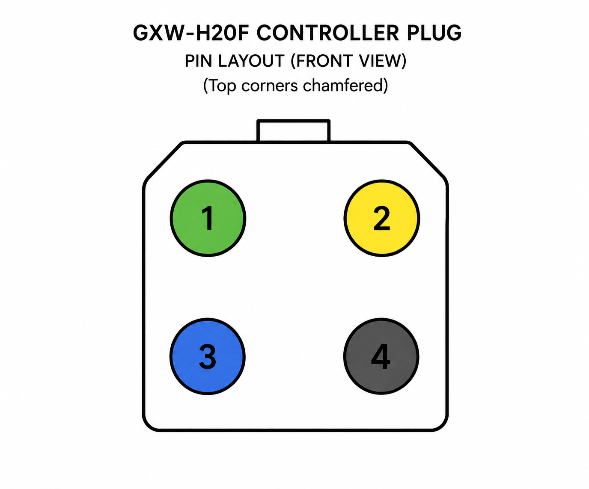

# Hardware, wiring, and safety

This project directly controls a DJI RoboMaster S1 Motion Controller over
SocketCAN. It does not use the DJI Wi-Fi Python SDK, and it does not require the
original gimbal/intelligent controller during normal operation. Retain the original
assembly for [DJI chassis calibration](chassis-calibration.md), which resolved a
stationary rollover fault on this installation.

## Validated hardware

The complete tested path is:

```text
Ubuntu PC or Jetson Orin Nano
  -> USB
  -> DSD TECH SH-C31A (gs_usb, USB ID 1d50:606f)
  -> CAN-H / CAN-L / GND
  -> RoboMaster S1 Motion Controller
  -> four original DJI M-BUS motors
```

The adapter carries CAN signaling only. Power the Motion Controller and motors
from an appropriate RoboMaster power source; do not attempt to power the chassis
from USB.

## Wiring rules

- Connect CAN-H to CAN-H and CAN-L to CAN-L.
- Connect signal ground between the adapter and Motion Controller.
- Verify terminal labels on the actual adapter and controller. Do not rely on
  wire colors from a photograph or another cable.
- Use a twisted pair for CAN-H/CAN-L and keep wiring reasonably short.
- The bus must have correct termination. With all equipment powered off, a
  correctly terminated two-ended CAN bus normally measures about 60 ohms
  between CAN-H and CAN-L.
- Do not connect or disconnect wiring while the chassis can move unexpectedly.

The connector numbering used during the physical investigation is shown below.
It is a front view with the upper corners chamfered. The diagram identifies pin
positions only; verify CAN-H, CAN-L, ground, and supply electrically on the
actual cable before connecting an adapter.



## CAN settings

The validated settings are:

```text
Classic CAN
11-bit arbitration ID
1,000,000 bit/s
txqueuelen 1000
```

Configure an interface once with:

```bash
sudo ./scripts/watch_can0.sh --interface can0 --once
```

On the validated Jetson, native MTTCAN occupies `can0`, so the SH-C31A appears
as `can1`:

```bash
sudo ./scripts/watch_can0.sh --interface can1 --once
```

Do not configure `restart-ms` for this adapter. The SH-C31A/`gs_usb` combination
reported that bus-off restart is unsupported. The included monitor recovers by
explicitly cycling the interface down and up.

## Mandatory first-motion procedure

First complete the [stationary calibration and ten-minute keepalive checks](chassis-calibration.md).
Healthy CAN traffic alone does not prove the controller remains enabled.

1. Lift the chassis so all four wheels are clear of the ground.
2. Confirm that no other program is transmitting wheel commands.
3. Start with a raw command near `30` and a duration of one second.
4. Keep access to `Ctrl-C` and the chassis power switch.
5. Verify every direction before placing the robot on the floor.
6. Test command timeout, process shutdown, USB removal, CAN recovery, and reboot
   while the wheels remain lifted.

The test utility limits duration to five seconds and always sends zero during
shutdown:

```bash
.venv/bin/python -m s1_can.test_drive forward \
    --interface can1 \
    --command 30 \
    --duration 1
```

## Confirmed wheel mapping

Public API order:

```text
w1 = front right
w2 = front left
w3 = rear left
w4 = rear right
```

Confirmed physical patterns in that order:

| Motion | FR | FL | RL | RR |
|---|---:|---:|---:|---:|
| Forward | + | + | + | + |
| Backward | - | - | - | - |
| Right | - | + | - | + |
| Left | + | - | + | - |
| Clockwise | - | + | + | - |
| Counter-clockwise | + | - | - | + |

ROS uses positive X forward, positive Y left, and positive Z
counter-clockwise. The driver therefore uses:

```text
front_right = vx + vy + wz
front_left  = vx - vy - wz
rear_left   = vx + vy - wz
rear_right  = vx - vy + wz
```

This coordinate conversion exists in one place:
`s1_can.chassis.mix_ros_velocity`.

## Safety mechanisms

- `S1Chassis` refreshes heartbeat and wheel packets in a background thread.
- A stale command becomes `(0, 0, 0, 0)` after `command_timeout`.
- The ROS node separately expires `/cmd_vel` after `cmd_vel_timeout`.
- USB/CAN loss clears the active command.
- Recovery sends workmode, the legacy heartbeat, and zero; it never replays motion from
  before the disconnect.
- `stop()`, `Ctrl-C`, and systemd `SIGINT` shutdown send a final zero when CAN is
  available.

Software safety is not a substitute for an accessible physical power cutoff.
